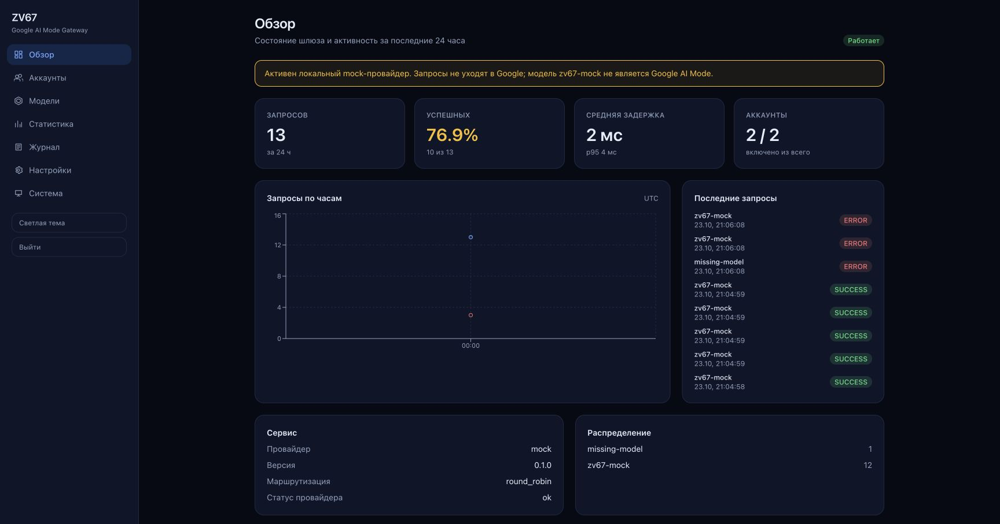

# ZV67 — Google AI Mode Agent Gateway

Локальный шлюз с OpenAI-совместимым API, мультиаккаунтным управлением, сессиями, статистикой и веб-панелью. Проект создан как основа для подключения Google AI Mode к Codex через OpenCodeX.

## Текущее состояние

Что работает и проверено:

- FastAPI-сервер на `127.0.0.1:18080`;
- Chat Completions, включая SSE streaming;
- Responses API с событиями streaming;
- детерминированный mock-провайдер `zv67-mock`;
- SQLite с миграциями Alembic;
- управление аккаунтами, лимитами параллельности и весами;
- стратегии round-robin, weighted round-robin, least-busy, manual и sticky-сессии;
- шифрование credentials и истории диалогов;
- административная панель с авторизацией, CSRF и аудитом;
- статистика запросов, ошибок и задержек;
- регистрация провайдера `zv67` в установленном OpenCodeX.

Что не работает:

- реальный backend Google AI Mode: **UNSUPPORTED**. Официального API нет, а рабочий метод XD06 требует обхода антибот-защиты Google, что запрещено техническим заданием;
- tool calling в ZV67: **UNSUPPORTED**. Поэтому Codex CLI с моделью `zv67-mock` получает ошибку на этапе инструментов;
- выбор модели в нативном интерфейсе Codex Desktop: **NOT TESTED**. Приложение Codex Desktop недоступно для автоматизированной проверки интерфейса.

Модель `zv67-mock` не выдаётся за Google AI Mode. Запросы к ней не уходят в интернет.

## Архитектура

```text
Codex Desktop / CLI
        |
        v
     OpenCodeX
        |
        v
   ZV67 Gateway
   |          |
 API        Dashboard
   |
 Session Manager
   |
 Account Router
   |
 UpstreamProvider
   |
   mock
```

CLIProxyAPI в цепочку не входит и не изменялся.

Подробности: [ARCHITECTURE.md](ARCHITECTURE.md), [docs/IMPLEMENTATION_PLAN.md](docs/IMPLEMENTATION_PLAN.md), [docs/FEASIBILITY.md](docs/FEASIBILITY.md).

## Установка

Требования: macOS на Apple Silicon, Python 3.12+, Node.js 20+.

```bash
cd /Users/orfeev/Desktop/Projects/ZV67
./scripts/install.sh
```

Установщик создаёт виртуальное окружение backend, собирает frontend, инициализирует базу в `~/Library/Application Support/ZV67`, устанавливает LaunchAgent и запускает сервис. LaunchAgent использует мастер-ключ в файле с правами `0600`, чтобы старт не зависел от диалогов Keychain.

Проверка:

```bash
./scripts/zv67 doctor
curl -s http://127.0.0.1:18080/health
```

Панель: `http://127.0.0.1:18080/admin/`. При первом открытии задаётся пароль администратора.

## Запуск вручную

```bash
cd backend
uv venv .venv
uv pip install --python .venv/bin/python -e '.[dev]'
.venv/bin/python -m uvicorn zv67.main:app --host 127.0.0.1 --port 18080
```

Для разработки панели:

```bash
cd frontend
npm install
npm run dev
```

Vite проксирует `/admin/api` на порт 18080.

## Настройка Google-аккаунтов

Откройте панель, раздел «Аккаунты», создайте профиль и нажмите «Credentials». Принимается JSON из Cookie-Editor, файл Netscape и строка `name=value; name2=value2`. Значение шифруется мастер-ключом; в журналы и Git оно не попадает.

Пример структуры:

```json
[{"name": "__Secure-1PSID", "value": "..."}]
```

Не вставляйте cookies в чат, issue, логи или файлы репозитория. Пароль Google не запрашивается.

Импорт cookies сам по себе не включает Google AI Mode: реальный адаптер имеет статус UNSUPPORTED. Профили и их изоляция работают с mock-провайдером и подготовлены для будущего разрешённого адаптера.

## Подключение OpenCodeX

Провайдер уже добавлен в `~/.opencodex/config.json`:

```text
provider: zv67
adapter:  openai-chat
baseUrl:  http://127.0.0.1:18080/v1
model:    zv67-mock
```

Проверка:

```bash
ocx provider test zv67 --model zv67-mock --yes
ocx models list
```

Перед изменением конфигурации создан backup: `~/.opencodex/config.json.backup-zv67-20261024`.

Отключение провайдера:

```bash
ocx provider remove zv67
```

Команда меняет общий конфигурационный файл; сначала сделайте backup.

## API

```bash
curl -s http://127.0.0.1:18080/health
curl -s http://127.0.0.1:18080/v1/models

curl -s -X POST http://127.0.0.1:18080/v1/chat/completions \
  -H 'Content-Type: application/json' \
  -d '{"model":"zv67-mock","messages":[{"role":"user","content":"ping"}]}'
```

При заданном `ZV67_API_KEY` добавьте заголовок `Authorization: Bearer <key>`.

Streaming включается полем `"stream": true`. Responses API: `POST /v1/responses`.

## Панель



Скриншоты сняты на тестовом профиле с mock-провайдером. Аккаунты Google — демонстрационные записи; реальные cookies в репозиторий не попадали.

Разделы: обзор, аккаунты, модели, статистика, журнал, настройки, система. Данные приходят из Management API; фиктивных метрик нет.

## Безопасность

- сервер по умолчанию слушает только `127.0.0.1`;
- пароль администратора хранится как scrypt-хеш;
- сессия панели — HttpOnly cookie, SameSite=Strict;
- изменяющие запросы защищены CSRF-токеном;
- credentials и история шифруются Fernet-ключом из Keychain;
- журналы не содержат промптов и cookies;
- удаление аккаунта удаляет его credentials и сессии.

Подробнее: [SECURITY.md](SECURITY.md).

## Обновление и управление

```bash
./scripts/zv67 start
./scripts/zv67 stop
./scripts/zv67 restart
./scripts/zv67 status
./scripts/zv67 logs
./scripts/zv67 doctor
```

## Известные ограничения

1. Google AI Mode недоступен без разрешённого официального механизма.
2. Tool calling не реализован; агентский режим Codex не подтверждён.
3. Codex Desktop может показывать модель из каталога OpenCodeX, но фактический выбор в UI не проверен.
4. Точная статистика токенов Google недоступна и не выдумывается.
5. Приложение рассчитано на один локальный Mac без контейнеров и внешних сервисов.

## Лицензия

Собственный код проекта. Сторонний код XD06/google-ai-mode не копировался.

